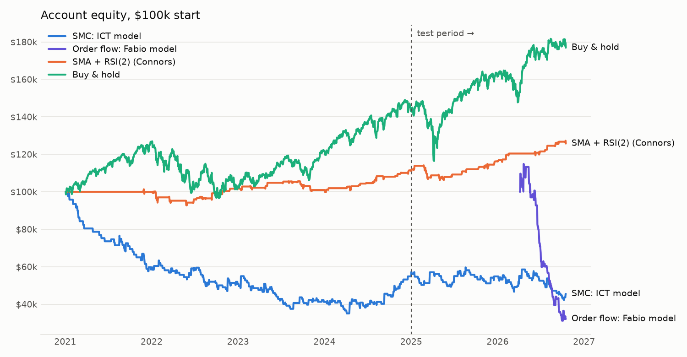
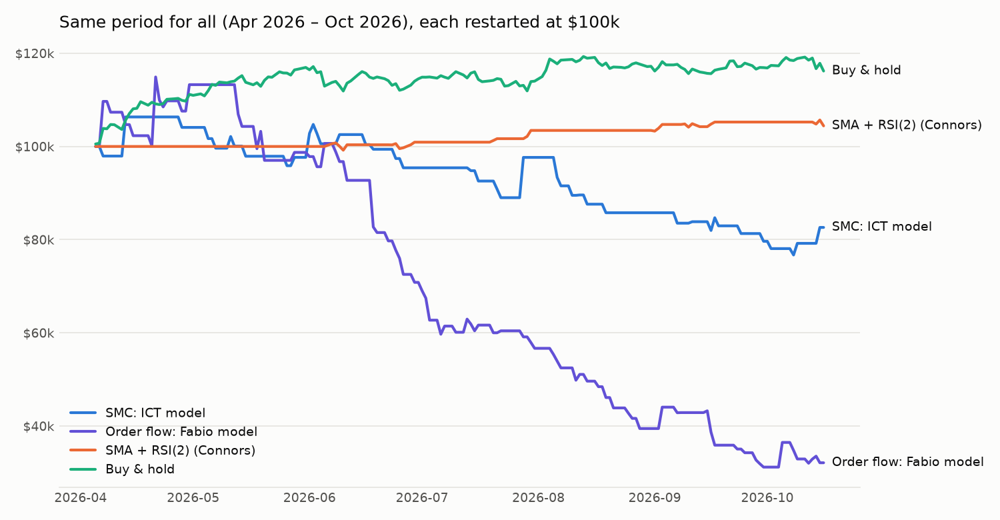
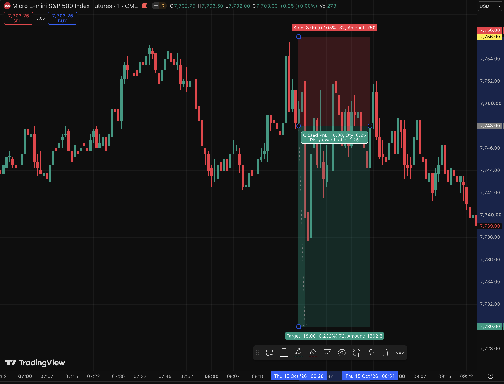
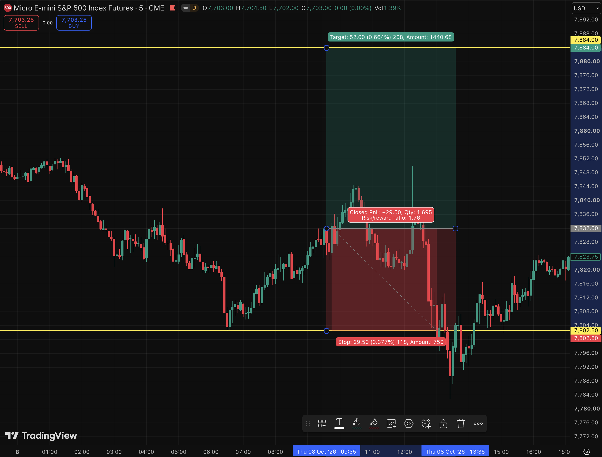
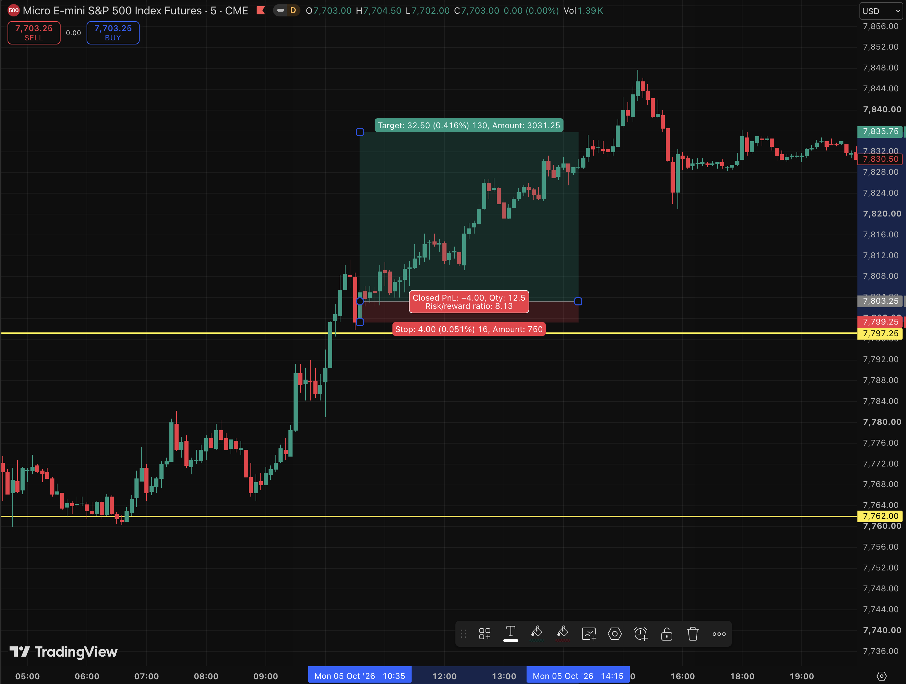

# Do popular day-trading strategies beat random entries? A backtest on 5 years of MES futures

[](https://github.com/samvratgowda/SMC-vs-Baselines/actions/workflows/tests.yml)

By Samvrat Gowda

## Summary

**Question:** Do two popular discretionary day-trading methods, a Smart Money
Concepts (SMC) model built from the Inner Circle Trader's (ICT) concepts and
Fabio Valentini's order-flow model, have an edge on S&P 500 futures once their
rules are written down and tested properly?

**Method:** Each method has fixed rules to enter a trade on Micro E-mini
S&P 500 (MES) futures using 1-minute candle data from January 2021 to October
2026, including trading costs. The 2 strategies are compared with buy-and-hold,
a classic SMA + RSI strategy, and a **random-entry control** (500 runs with
the same stops, targets and costs but random entries). Rules were fixed
before the real data was run so there was no bias towards the specific
chart's price action.

**Findings:**
- **SMC (ICT model):** 355 trades, −0.08R per trade, exactly the median of the
  random-entry runs. The entry signals did no better than chance.
- **Order flow (Fabio model):** 124 trades, −0.46R per trade, the only
  statistically clear loss. Most of it came from tight stops and costs;
  random entries with the same risk lost −0.31R.
- **Buy-and-hold:** +76.9%, the highest return.
- **SMA + RSI(2):** +25.7% with a similar Sharpe ratio (return per unit of risk) to
  buy-and-hold (0.74 vs 0.69) and about a third of the drawdown.



> **Scope of the claim.** These are mechanical versions of discretionary methods.
> The conclusion this project can support is "these rules did X on this data",
> not "SMC does/doesn't work".

## What was tested

| | Entries | Stop | Target |
|---|---|---|---|
| **SMC: ICT model** | 1-minute bars. With the 4h bias, a previous-day / Asia / London / hourly low is swept; a 5m candle closes back through the latest swing or an inverse FVG; price pulls back into the new 5m FVG (or the move's 50%); a 1m break of structure or inverse FVG out of it triggers a market entry, 08:00–11:00 ET. | Sweep extreme | Nearest untaken liquidity ≥ 1R away |
| **Order flow: Fabio model** | 1-minute order-flow bars. Balance = previous day's value area. Trend: a 5m close outside value, then a pullback into a low-volume node (LVN) of the impulse leg's volume profile. Mean reversion: a failed push outside value, a 5m close back inside, then a pullback into an LVN of the reclaim leg. Both need aggression at the LVN (a big aggressive order or 3+ stacked footprint imbalances); market entry, 08:00–11:00 ET. | 2 ticks beyond the aggression bar / LVN | Previous balance POC (trend) or balance POC (mean reversion), ≥ 1R |
| **SMA + RSI(2) (Connors)** | Daily bars. Long when the close is above its 200-day SMA and RSI(2) < 10; short when below the 200-day SMA and RSI(2) > 90. Flat between trades. Sized at 100% of equity. From Connors & Alvarez, *Short Term Trading Strategies That Work* (2008); Pine version: `pine/sma_rsi_daily.pine`. | none | close back across the 5-day SMA |
| **Buy & hold** | Buy at the start, hold to the end, roll each quarter. Sized so notional ≈ starting capital (no leverage). | none | none |

Every SMC rule and its source is in [`STRATEGY_RULES.md`](STRATEGY_RULES.md),
and every order-flow rule in [`ORDERFLOW_RULES.md`](ORDERFLOW_RULES.md);
where a source leaves a rule open, the choice is marked. How the engine fills
trades, the lookahead tests, the random-entry control and how to read the
statistics are in [`docs/METHODOLOGY.md`](docs/METHODOLOGY.md).

## Results

### Headline numbers

| Strategy | Period | Trades | Avg R per trade (95% CI) | Return | Sharpe | Max drawdown |
|---|---|---|---|---|---|---|
| **Buy & hold** | Jan 2021 – Oct 2026 | 1 | – | **+76.9%** | 0.69 | −23.7% |
| SMA + RSI(2) (Connors) | Jan 2021 – Oct 2026 | 63 | – | +25.7% | **0.74** | **−8.5%** |
| SMC: ICT model | Jan 2021 – Oct 2026 | 355 | −0.08 (−0.24 to +0.08) | −54.5% | −0.43 | −65.0% |
| Order flow: Fabio model | Apr 2026 – Oct 2026 | 124 | −0.46 (−0.76 to −0.14) | −67.9% | −3.45 | −72.9% |

- **R** is the ratio of the trade's profit to the amount risked. The 95%
  confidence interval comes from 10,000 bootstrap resamples of the trades.
  An interval that includes zero means the sample can't tell an edge from luck.
- Both day-trading models risk 2% of equity per trade (1–100 contracts).
  Average R doesn't depend on position size; return, Sharpe and drawdown do.
  Buy-and-hold and RSI(2) have no stop, so no R.
- Order-flow data costs much more than candle data for SMC so that test covers
  6.5 months instead of 5.8 years.

### Did the signals beat random entries?

For each model, 500 random runs took the same number of trades over the same
period and entry window (08:00–11:00 ET), with the same exit time, costs, and
stop and target sizes (drawn from the model's own trades), but on random days
and minutes in a random direction.

| | SMC: ICT model | Order flow: Fabio model |
|---|---|---|
| Strategy avg R | −0.08 | −0.46 |
| Random runs: median avg R | −0.08 | −0.31 |
| Random runs: 95% range | −0.24 to +0.05 | −0.59 to +0.15 |
| Random runs worse than the strategy | 48% | 16% |

- **SMC:** the result sits exactly in the middle of the random runs. The
  sequence of sweep, break of structure, pullback and 1-minute confirmation
  picked entries no better than coin flips with the same risk management.
- **Order flow:** random entries with the same tight stops lost −0.31R on
  their own, so most of the strategy's loss comes from its risk structure and
  costs, not its signals. The signals did slightly worse than the median
  random run, but well inside the random range: no evidence they help or hurt.

### SMC: ICT model

| | Trades | Avg R (95% CI) | Return | Sharpe |
|---|---|---|---|---|
| Train, 2021–2024 | 234 | −0.10 (−0.30 to +0.12) | −45.2% | −0.49 |
| Test, 2025 – Oct 2026 | 121 | −0.06 (−0.32 to +0.22) | −17.1% | −0.41 |
| **Full** | **355** | **−0.08 (−0.24 to +0.08)** | −54.5% | −0.43 |

The rules lost money in both the training period and the held-out test
period. The confidence interval includes zero, so on its own this is "no
detectable edge"; together with the random-entry control, the signals added
nothing. Win rate 34%, profit factor 0.80. The large drawdown (−65%) comes
mostly from risking 2% per trade on a losing strategy; at 0.5% per trade the
same trades would have drawn down roughly a quarter as much.

Where setups dropped out at each step: see the [setup funnels](docs/METHODOLOGY.md#setup-funnels).

### Order flow (Fabio model)

124 trades from April 5 to October 16, 2026 averaged **−0.46R** per trade
after costs (95% CI −0.76 to −0.14), the only strategy whose loss is
statistically clear. Win rate 19%, profit factor 0.55. At 2% risk per trade,
losing about half a risk unit per trade cost 68% of the account in six and a
half months (max drawdown −73%).

| | Avg R per trade |
|---|---|
| Before costs | −0.22 |
| Costs (commission + slippage) | −0.25 |
| **After costs** | **−0.46** |

(Each figure is rounded to two decimals, so the parts don't add exactly.)

With a median stop of 4 points, a round trip of commission plus a tick of
slippage on entry and stop costs about a quarter of the risk. The random-entry
control shows the same risk structure loses about −0.31R even with random
entries.

| Setup | Trades | Avg R |
|---|---|---|
| Trend (breakout from value) | 62 | −0.37 |
| Mean reversion (failed breakout) | 62 | −0.55 |

Both setups lost; with 62 trades each, the gap between them isn't reliable.

Setup funnel: [docs/METHODOLOGY.md](docs/METHODOLOGY.md#setup-funnels).

### SMA + RSI(2) (Connors)

| | Trades | Win rate | Avg trade (95% CI) | Return | Sharpe | Max drawdown |
|---|---|---|---|---|---|---|
| Train, 2021–2024 | 39 | 72% | $308 (−$66 to $661) | +11.2% | 0.52 | −8.5% |
| Test, 2025 – Oct 2026 | 24 | 83% | $573 (−$195 to $1,135) | +12.9% | 1.21 | −6.8% |
| **Full** | **63** | **76%** | **$409 ($35 to $729)** | **+25.7%** | **0.74** | **−8.5%** |

The standard rules, unchanged from Connors & Alvarez (2008), made money in
both periods. Over the full period the average trade is positive with
statistical confidence (bootstrap p = 0.02), and the strategy was in the
market only 15% of the time, with a third of buy-and-hold's drawdown and a
similar Sharpe ratio (0.74 vs 0.69). It still returned far less than simply
holding (+25.7% vs +76.9%). This matches
[published tests of RSI(2) on the S&P 500](https://backtrex.com/en/backtests/connors-rsi-2-sp-500): a real short-term mean-reversion effect, but not one that beats
buy-and-hold on return. With 63 trades the sample is small, and the small
Sharpe difference isn't evidence that it's better than holding.

(This project originally used a different SMA + RSI rule set. It was
replaced by the standard Connors version because that one is the published,
widely used reference; its rules were taken as published, not tuned.)

### All four strategies over the same six months

April 5 – October 16, 2026, the period covered by the order-flow data:

| Strategy | Return | Sharpe | Max drawdown | Trades | Avg R |
|---|---|---|---|---|---|
| **Buy & hold** | **+16.2%** | **1.94** | −5.1% | 0 | – |
| SMA + RSI(2) (Connors) | +4.4% | 1.54 | −1.8% | 8 | – |
| SMC: ICT model | −17.4% | −1.17 | −27.9% | 42 | −0.21 |
| Order flow: Fabio model | −67.9% | −3.45 | −72.9% | 124 | −0.46 |



### What these results do and don't show

- They show that **these mechanical rules** did no better than random entries
  and lost to buy-and-hold on MES over these dates, with costs included and
  rules fixed before the real data was run.
- They don't show whether ICT, Fabio Valentini, or anyone trading these
  ideas with judgment makes money. Discretion can't be backtested.
- One market, one period for each strategy. The order-flow sample (6.5
  months, 124 trades) is much smaller than the SMC sample.
- Databento flagged a handful of days as reduced data quality; they were
  kept.
- The SMC and order-flow results match large studies of day traders: in
  Brazil, 97% of people who day-traded futures for 300+ days lost money
  ([Chague, De-Losso & Giovannetti](https://ideas.repec.org/p/fgv/eesptd/525.html));
  in Taiwan, under 1% earned reliable profits after fees
  ([Barber, Lee, Liu & Odean, 2014](https://ideas.repec.org/a/eee/finmar/v18y2014icp1-24.html)).

### Hand-checked trades

Three trades from after the September 2026 contract roll, checked by eye on
TradingView's MES1! chart, which uses a different data vendor than Databento.
Prices since that roll are identical in both, because back-adjustment only
shifts older prices. Times are New York time; the yellow lines and position
boxes were drawn by hand from the backtest's trade list.

**1. SMC: ICT model, short, Oct 15 2026: target hit (+2.14R)**



The 07:37 candle trades up to 7756.00 (yellow line), sweeping the Asia-session
high. Price then breaks down through an earlier fair value gap (the 5-minute
inverse FVG at 07:59), pulls back into the new bearish gap near 7746.50 without
reaching the stop, and the 1-minute confirmation triggers a short at 08:28 at
7748.00. Stop 7756.00 at the sweep high; target 7730.50, the latest hourly
swing low. Price reaches the target at 08:30, as in the backtest.

**2. SMC: ICT model, long, Oct 8 2026: stopped out (−1.02R)**



The previous day's low is swept at 06:25, with a low of 7802.50 (lower yellow
line). Price shifts structure upward (5-minute inverse FVG at 07:49), pulls
back into the bullish gap near 7828, and the 1-minute confirmation triggers a
long at 09:35 at 7832.00. Stop 7802.50 at the sweep low; target 7884.50, the
previous day's high (upper line). Price peaks near 7845 and falls through the
stop at 13:00, as in the backtest.

**3. Order flow: Fabio model, long, Oct 5 2026: target hit (+8.0R)**



The yellow lines are the previous trading day's value area (7762.00–7797.25).
A 5-minute candle closes above the value-area high around 10:00 (trend model:
out of balance). The impulse leg runs from 7765.00 to 7811.25; price pulls
back into a low-volume node of that leg at 7803.25, and stacked buy imbalances
on the 10:37 bar trigger a long at 10:38 at 7803.25. Stop 7799.25; target
7835.75, the point of control of an earlier day's balance. Price reaches the
target at 14:57.

TradingView's position tool marks this trade as stopped out, because it counts
the whole 10:35 five-minute bar, including the pullback low just before the
10:38 entry. On 1-minute bars the backtest finds no trade below the stop after
the entry; TradingView's free plan doesn't show 1-minute bars that far back,
so that detail couldn't be checked by eye. The order-flow signal itself
(stacked imbalances) isn't visible on a standard chart either.

In screenshots 1 and 2 the target edge of the position box was drawn half a
point off (7730.00 and 7884.00 instead of 7730.50 and 7884.50); this doesn't
change either outcome.

To reproduce: download the data (see [Reproduce it](#reproduce-it)), then
`python run_backtest.py --split 2025-01-01`. The settings used are printed at
the top of `results/summary.md`.

## Reproduce it

```bash
git clone https://github.com/samvratgowda/SMC-vs-Baselines.git && cd SMC-vs-Baselines
pip install -r requirements.txt
python -m pytest -q && python run_backtest.py --synthetic
```

That checks everything on generated data, no account needed. For real data,
get a free [Databento](https://databento.com/signup) API key, then:

```bash
export DATABENTO_API_KEY=db-...
python scripts/download_data.py --start 2021-01-01
python run_backtest.py --split 2025-01-01
```

The 1-minute MES bars cost about $7.50 of Databento's $125 free credit. The
order-flow strategy is optional: it needs trade-level data (about $8 per
month of MES), downloaded with `scripts/download_orderflow.py`. Full
instructions are in [`docs/METHODOLOGY.md`](docs/METHODOLOGY.md).

## Limitations

- These are mechanical versions of discretionary methods; discretion can't be
  backtested.
- One market (MES). The order-flow test covers 6.5 months, the rest 5.8 years.
- 1-minute bars, no tick data: the order of prices inside a bar is assumed
  (pessimistically: when a bar touches both stop and target, the stop counts).
- Costs are $1 per contract per side plus 1 tick of slippage on market and
  stop orders, a rough estimate of a retail trader's all-in cost.

More detail: [`docs/METHODOLOGY.md`](docs/METHODOLOGY.md#limitations).

## How this was built

<!-- Edit this so it matches exactly what you did. -->
I designed the research question, chose the strategies and baselines, fixed
the rules and settings before running the real data, ran the experiments and
interpreted the results. Most of the code was written with an AI assistant
(Claude). I reviewed it, ran the test suite, and can explain how each part
works.
